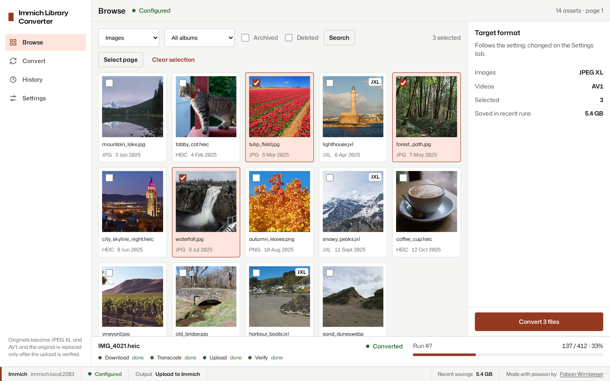
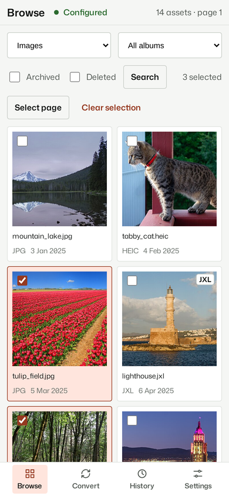
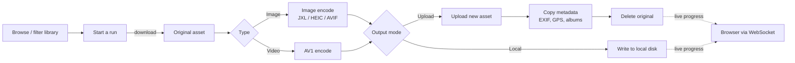

# Immich Library Converter

[](https://github.com/fabianwimberger/immich-convert-originals/actions)
[](https://codecov.io/gh/fabianwimberger/immich-convert-originals)
[](https://github.com/fabianwimberger/immich-convert-originals/pkgs/container/immich-convert-originals)
[](https://opensource.org/licenses/MIT)

> **Disclaimer**: This is an independent, community-created project. It is **not affiliated with, endorsed by, or sponsored by Immich**. "Immich" and its associated logos are trademarks of their respective owners. Use of the name is solely for identification and compatibility purposes. Use at your own risk.

A self-hosted, web-based tool that batch-transcodes your Immich library to modern, space-efficient formats:
- **Images** → JPEG XL, HEIC, or AVIF (your choice)
- **Videos** → AV1 (MP4 container)

Browse your library, pick what to convert, and watch live progress in the browser — download, transcode, upload (or save locally instead), and remove the original only once the upload is verified.

## Background

JPEG XL shrinks photos by 20-40% and AV1 shrinks videos by 30-50% with no visible quality loss. On a multi-TB Immich library that adds up fast.

| Desktop | Mobile |
|---------|--------|
|  |  |

## Features

- **Asset browser** — filter by type, album, archived/deleted state; thumbnails are proxied through the backend, so the API key never reaches the browser
- **Run scoping** — whole library, one album, a date range, or a selection from Browse
- **Image conversion** — JPEG, PNG, WebP, HEIC, AVIF, TIFF, GIF, BMP → JPEG XL, HEIC, or AVIF; JPEG → JXL is a lossless bit-exact repack; input formats can be excluded from a run
- **Video conversion** — MP4, MOV, MKV → AV1 (MP4)
- **Local-only mode** — writes to `<year>/<month>` folders on disk instead of uploading, optionally keeping the original alongside; Immich is never touched
- **Metadata preservation** — EXIF, GPS, favorite state, rating, and albums are copied to the replacement asset
- **Live and motion photos** — the still is converted and stays linked to its video; motion photos with an embedded video (Google, Samsung, OnePlus) are stored as the still alone; re-encoding the video to AV1 is optional and off by default; local-only mode saves the video next to the still
- **Retry and resume** — retries with more compression if the output is larger than the original; a later run skips assets already converted
- **Run history** — per-asset outcomes for every run; retry only the failures or export them as CSV
- **Dry-run and live progress** — preview what a run would do; progress arrives over WebSocket
- **Settings in the UI** — connection, formats, quality, output mode, and retry behavior; no restart or `.env` file

## Quick Start

Open `http://localhost:8000` afterwards and enter the Immich URL and API key on the Settings page. The URL must include the `/api` suffix, e.g. `https://photos.example.com/api`.

### Option 1: Prebuilt Docker Image (Recommended)

Multi-arch image (`linux/amd64`, `linux/arm64`).

```bash
mkdir -p immich-converter/data && cd immich-converter
docker run -d \
  --name immich-library-converter \
  --restart unless-stopped \
  -p 8000:8000 \
  -v ./data:/app/data \
  ghcr.io/fabianwimberger/immich-convert-originals:latest
```

Create `data/` yourself as shown: Docker creates a missing bind-mount source as root, and the container runs as uid 1000.

### Option 2: Docker Compose (Build Locally)

```bash
git clone https://github.com/fabianwimberger/immich-convert-originals.git
cd immich-convert-originals
mkdir -p data
docker compose up -d
```

### Option 3: Local Development

Needs `ffmpeg`, ImageMagick with the JXL and HEIC/AVIF delegates, `libjxl-tools`, and `exiftool` on the host.

```bash
python -m venv .venv
.venv/bin/python -m pip install -e '.[dev]'

FRONTEND_DIR=./frontend \
DATABASE_PATH=./data/app.db \
TEMP_DIR=./data/temp \
.venv/bin/uvicorn app.main:app --app-dir backend --reload --port 8000
```

## How It Works



Each asset is downloaded to a per-run temporary directory, transcoded (skipped if it is already in the target format), and validated; an output larger than the input is retried with more compression.

In upload mode the new asset is uploaded, its metadata is copied, and the upload is verified. Only then is the original deleted, which moves it to Immich's trash for 30 days. In local mode the file is written to `<local output dir>/<year>/<month>/` and nothing in Immich changes.

If any step fails, the new asset is cleaned up and the original is preserved. The outcome is recorded either way, so a failed run shows up in History with the exact error.

## Configuration

Everything behavioral — Immich connection, encoding defaults, filters, output mode — is configured from the **Settings** page in the web UI, no restart required. The only environment variables the app reads are infrastructure that has to exist before the database is reachable, and none of them need to be set for a normal install:

| Variable | Description | Default |
|----------|-------------|---------|
| `DATABASE_PATH` | Path to the app's SQLite database (settings + run history) | `/app/data/app.db` |
| `TEMP_DIR` | Scratch directory for in-flight downloads/transcodes | `/app/temp` |
| `LOG_LEVEL` | Log verbosity | `INFO` |
| `CORS_ORIGINS` | Comma-separated origins allowed to call the API | `http://localhost:8000,http://127.0.0.1:8000` |

## Security & Safety

**USE AT YOUR OWN RISK.** In upload mode this tool deletes originals after conversion (recoverable via Immich trash for 30 days) — always back up first and test on a small selection before converting a whole library. The web UI has no built-in authentication — it's intended for a trusted home network or behind your own reverse-proxy auth; don't expose it directly to the internet.

## Troubleshooting

| Symptom | Cause / fix |
|---------|-------------|
| Connection test fails with a 404 | The Immich URL must point at the API root and include the `/api` suffix, e.g. `http://immich:2283/api` or `https://photos.example.com/api`. |
| Connection test or uploads fail with 401/403 | The API key is missing a needed scope. Create it with asset read **and** asset upload permissions in Immich → Account Settings → API Keys; a read-only key authenticates but fails on upload. |
| Assets shared by a partner are skipped | They belong to another account, so the API key can't replace them in upload mode; they're skipped instead of failing. Local output mode can still convert them. |
| External library assets are skipped | An upload can't be written into an external library's folder. Use local output mode, or enable **Convert external library assets** in Settings → Output: the converted file then moves into Immich's own storage and the original is deleted from the external folder when Immich empties its trash. |
| `Permission denied` writing to `/app/data` | The container runs as uid 1000, but a bind-mount source created by Docker is root-owned. Create the host `data/` directory yourself before the first run (`mkdir -p data`). |
| Transcode fails with a codec or delegate error | Local runs need `ffmpeg`, ImageMagick with the JXL/HEIC/AVIF delegates, `libjxl-tools`, and `exiftool` on the host. Use the Docker image to avoid host codec gaps. |

## Docker Image Tags

Images are available from `ghcr.io/fabianwimberger/immich-convert-originals`. Use `latest` for the latest release, or pin to a release tag (`v2`, `v2.0`, `v2.0.0`).

## License

MIT License — see [LICENSE](LICENSE) file.

### Third-Party Licenses

| Component | License | Source |
|-----------|---------|--------|
| libjxl | [BSD-3-Clause](https://github.com/libjxl/libjxl/blob/main/LICENSE) | https://github.com/libjxl/libjxl |
| FFmpeg | [GPL-2.0+](https://www.gnu.org/licenses/old-licenses/gpl-2.0.html) (Alpine build links x264/x265) | https://ffmpeg.org/ |
| libheif | [LGPL-3.0+](https://github.com/strukturag/libheif/blob/master/COPYING) | https://github.com/strukturag/libheif |
| ImageMagick | [Apache-2.0](https://imagemagick.org/script/license.php) | https://imagemagick.org/ |
| ExifTool | [Artistic/GPL](https://exiftool.org/#license) | https://exiftool.org/ |
| FastAPI | [MIT](https://github.com/fastapi/fastapi/blob/master/LICENSE) | https://fastapi.tiangolo.com/ |
| SQLAlchemy | [MIT](https://github.com/sqlalchemy/sqlalchemy/blob/main/LICENSE) | https://www.sqlalchemy.org/ |

This app invokes these as separate subprocesses and never links against them, so none of the above affects this project's own MIT license. See [DOCKER_LICENSES.md](DOCKER_LICENSES.md) for the full codec library breakdown (x264, x265, libaom, dav1d, rav1e, SVT-AV1) and what GPL/LGPL requires of anyone distributing the image.
